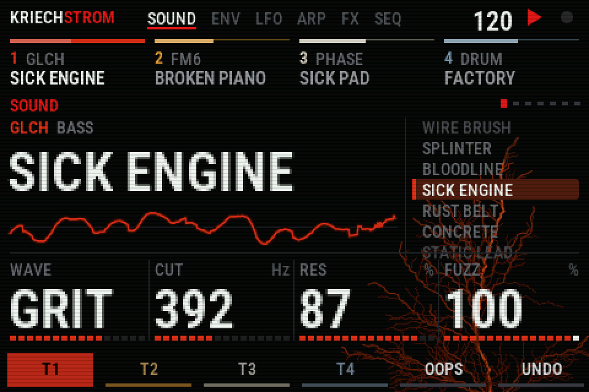
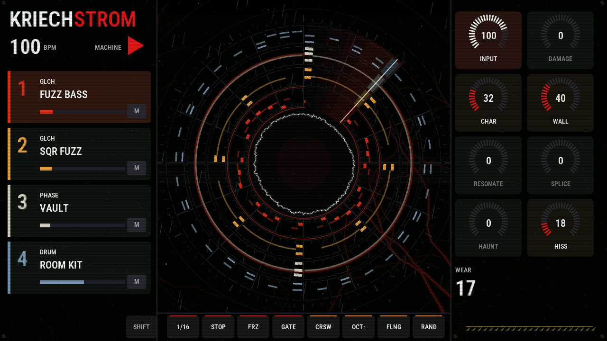

# KRIECHSTROM for VIBE FM

by Grigorii Bezborodov

Dark industrial and EBM groovebox for VIBE FM: a native Vibe, built with the VIBE FM SDK. It is the port of
[KRIECHSTROM](https://github.com/Xforsa/kriechstrom) for the M-VAVE FM-1, which is built on
[Felucca](https://github.com/hugelton/Felucca) by Leo Kuroshita (Hügelton Instruments), with parts of
[Glitchbox](https://github.com/erikdevos/glitchbox) by erikdevos. The sound engine is the FM-1 firmware's own code;
the screen, the controls, the audio input, MIDI OUT and the stage are new.



Site: https://xforsa.github.io/kriechstrom-vibe/ · for the FM-1: https://xforsa.github.io/kriechstrom/

Kriechstrom is German for creepage current: the leakage across worn insulation that leaves a branching mark. Here that
mark grows behind every page as the master wears the mix out.

## What it does

- **Four tracks, KRIECHSTROM's sound:** the Felucca engines and GLCH, FM6, PHYS, DRUM with KRIECHSTROM's kits, 171
  sounds, a 64-step sequencer per track (locks, conditions, ratchets, chords, the arpeggiator), DICE in eight moods,
  OOPS, the per-track pedals (INFECT with VOX among them) and the master chain: DAMAGE, WALL, RESONATE, SPLICE, HAUNT,
  HISS. At 44.1 kHz its output is the FM-1 core's, bit for bit (tests/run.sh checks it); at other rates it is
  resampled.
- **The 480 x 320 display:** pages for SOUND, ENV, LFO, ARP, FX and SEQ, the four values on encoders 1-4, the four
  tracks with their levels, a piano roll or a drum grid of the 16 steps on the pads, the whole pattern above it.
- **The display wears with the sound:** the creep figure grows with DAMAGE and WALL and pulses with the level; DAMAGE
  tears the picture on the drum hits, CHAR towards DIGITAL splits its colours, SPLICE cuts bands of it, HAUNT's DRAG
  sags it over the last beat of a bar, HISS adds grain.
- **The pads:** mute and DICE per track, hold effects (repeat 1/16, tape stop, freeze, gate), four drum lanes with
  velocity; on the SEQ page the pads are the 16 steps shown, lit as they play.
- **The audio input (IN 1, IN 2):** a guitar, a voice or a drum machine into the mix and through the whole master,
  with DRIVE, sends to the delay, reverb and chorus, a GATE opened by a track's notes, and as a track's stand-in for
  INFECT (a voice through the VOX vocoder on a pad, a guitar ducking the bass).
- **MIDI OUT:** every track's notes on its own channel (the sequencer, the arpeggiator, DICE's parts, the keys),
  24 PPQ clock, START and STOP.
- **CV and GATE:** one track's notes on CV OUT (1 V per octave) and GATE OUT.
- **The stage (960 x 540):** the four patterns at once with their playheads, the creep over the master's scope, the
  master's chain as knobs. Steps, tracks, mutes and knobs can be clicked, dragged or turned with the wheel; each also
  has its control on the device.
- **The DAW:** each track's mixer (the SDK's `mix_<n>_*`), its sound, envelope and sends, the master's effects as
  parameters; its transport and tempo; projects and settings stored with the DAW project.
- **Storage:** the music as it is now is kept by itself (`session.krp`), four project slots that SONG plays in a chain,
  32 user sounds. The files are KRIECHSTROM's FM-1 formats.



## Controls

| | |
|---|---|
| keys | play the selected track (its chord keys and arpeggiator) |
| pads 1-4 | mute a track (SHIFT: select it) |
| pads 5-8 | DICE: a new part for that track in the MOOD (SHIFT: the next MOOD) |
| pads 9-12 | held: repeat 1/16, tape STOP, FREEZE, GATE |
| pads 13-16 | KICK, SNARE, CLAP, HAT on the drum track, with velocity |
| SOUND ENV LFO ARP FX SEQ | the pages; the same key again: the next page of that family |
| ◀ ▶ | the family's pages |
| encoders 1-4 | the four values on the page |
| DATA | the sounds of the selected track (SHIFT: its engine); on SEQ the step cursor |
| A | the selected track's level |
| B | DAMAGE (SHIFT + B: WALL) |
| F1-F4 | select track 1-4 |
| F5 | the page's action: OOPS on SOUND, DICE on SEQ (SHIFT: MOOD), SAVE on PROJECT, the input's type on INPUT |
| F6 | UNDO |
| MENU | the mixer, the project slots, MIDI OUT and CV, the clock |
| PLAY, STOP, REC | the transport; REC arms the selected track for live recording |
| ENTER | on SEQ: the cursor's step on or off; on PROJECT: load the slot |
| HOME | what every control does; RETURN goes back to SOUND |

Every control on the display can also be reached with DATA and ENTER (hold ENTER for 0.6 s: FOCUS).

## Play it

- In the browser: open the [VIBE FM Playground](https://play.thefirmwarehub.com/) and drop `kriechstrom.wasm` onto
  the device.
- In a DAW: open VIBE FM VST and drop `kriechstrom.zip` onto its window.
- Both files are on the [releases](https://github.com/Xforsa/kriechstrom-vibe/releases) page. PLAY starts the four
  tracks' patterns at once.

## Build

Needs [Zig 0.13.0](https://ziglang.org/download/#release-0.13.0) (`zig` on the PATH or `ZIG=/path/to/zig`), Python 3
with Pillow and fontTools (the core's tables and fonts), a C compiler and Node.js 18+ for the tests.

```sh
git clone --recursive https://github.com/Xforsa/kriechstrom-vibe
cd kriechstrom-vibe
sh tools/build.sh          # build/kriechstrom.wasm and build/kriechstrom.zip
sh tests/run.sh            # the tests, vibe-check among them
```

## Layout

- `kriechstrom/` the firmware (its folder name is its id): `kriechstrom.c` builds everything as one unit, as the FM-1
  firmware does; `kx_core.h` the KRIECHSTROM sources, `kx_audio.h` the audio flow and the resampler, `kx_ctl.h` what
  the controls do in the core, `kx_input.h` the audio input, `kx_midi.h` MIDI OUT and CV, `kx_store.h` storage,
  `kx_daw.h` the DAW, `kx_ui.h` and `kx_draw.h` the pages, `kx_creep.h` and `kx_wear.h` the creep and the display's
  wear, `kx_stage.h` the stage. `icon.png` is drawn by `tools/make_icon.py`.
- `core/kriechstrom/` KRIECHSTROM for the FM-1, a git submodule. Its sound and edit code is used as it is; the one
  change for VIBE FM is a hook in `fx.c` for the audio input, empty in the FM-1 build.
- `sdk/`, `tools/vibe-build.sh`, `tools/vibe-check.mjs`, `tools/wasmtest.mjs`, `tools/media-host.mjs` from the
  [VIBE FM SDK](https://github.com/Vibe-FM-SDK/vibe-fm-sdk) (Apache-2.0, `sdk/VERSION` names its commit);
  `tools/vibe-build.sh` adds the generated headers' folders, `tools/kx-test.mjs` is `wasmtest.mjs` that also saves the
  stage.
- `site/` the site (GitHub Pages, `tools/make_site.sh`), in English and Russian.
- `tests/` the host tests: the core at 44.1 kHz against the FM-1 build, vibe-check, other rates, the input, MIDI OUT,
  storage.

## Licence

GPL-3.0-only, as KRIECHSTROM and Felucca; see [LICENSE](LICENSE), [LICENSING.md](LICENSING.md) and
[CREDITS.md](CREDITS.md). The VIBE FM SDK files keep their Apache-2.0 licence (`sdk/LICENSE`, `sdk/NOTICE`).
"VIBE FM" is a trademark of Sven Trogus; this firmware is built with the VIBE FM SDK.
